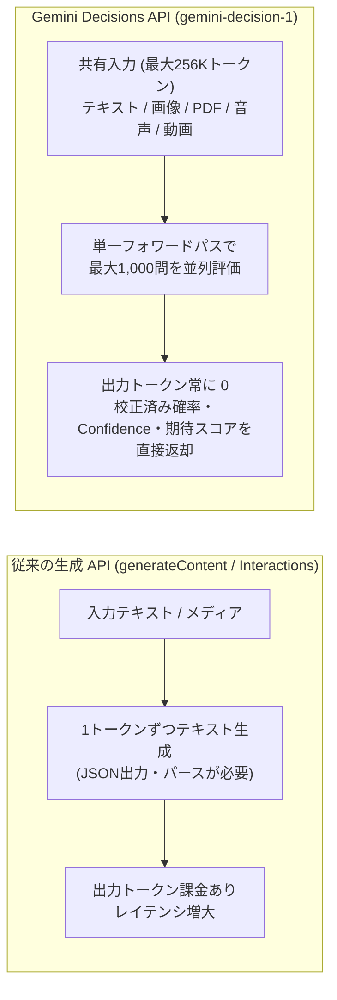

# Gemini Decisions API Python 導入・解説マニュアル

**Gemini Decisions API**（モデル: `gemini-decision-1`、エンドポイント: `/v1beta/decisions`）は、従来のテキスト生成型 LLM とは異なり、**分類・ルーティング・ポリシーチェック・ルーブリック採点**などの「閉じた選択肢（Closed-set）に対する判定」に特化した専用 API です。

---

## 1. Gemini Decisions API とは？

従来の生成 API（`generate_content` や `interactions.create`）では、分類や採点をさせる場合でも「JSON テキストを 1 トークンずつ生成 → パース → 信頼度の目安を自前で推定」という手順が必要でした。

Decisions API では、入力コンテキストを **1 回のフォワードパス（Prefill）** で処理し、テキストを一切生成せずに **キャリブレーション済みの確率分布・信頼度（Confidence）・期待スコア** を直接返します。



### 主な特徴と仕様

| 項目 | 仕様・特徴 |
| :--- | :--- |
| **専用モデル** | `gemini-decision-1` |
| **エンドポイント** | `POST https://generativelanguage.googleapis.com/v1beta/decisions` |
| **最大コンテキスト** | 共有入力として最大 **262,144 トークン（256K）** |
| **並列質問数** | 1 リクエストあたり **最大 1,000 問** の独立した質問を同時評価 |
| **出力トークン** | **常に 0**（テキスト生成なし・出力トークン課金なし） |
| **料金目安** | 入力トークンのみ課金（`$0.10 / 1M input tokens`） |
| **レイテンシ目安** | 低遅延（典型的に 150〜250ms 程度） |
| **対応モダリティ** | テキスト、画像、PDF/文書、音声、動画 |

---

## 2. Python 環境への導入手順

### 2.1 SDK のインストール・アップグレード

Decisions API（`client.decisions.create`）は公式 Python SDK **`google-genai` v3.2.0 以降** でサポートされています。

```bash
# uv を使う場合（推奨）
uv add "google-genai>=3.2.0"

# pip を使う場合
pip install -U "google-genai>=3.2.0"
```

インストール済みバージョンと `decisions` リソースの有無を確認するには以下を実行します。

```bash
python -c "from google import genai; print(genai.__version__); c = genai.Client(api_key='test'); print(hasattr(c, 'decisions'))"
```

### 2.2 API キーの設定

Google AI Studio で発行した API キーを環境変数または `.env` に設定します。

```env
GOOGLE_API_KEY="AIza..."
# または GEMINI_API_KEY="AIza..."
```

### 2.3 クライアント初期化時の重要な注意点（`v1beta` 指定）

> [!WARNING] `google-genai >= 3.0.0` のデフォルト API バージョン変更
> `google-genai` v3.0.0 以降、Gemini Developer API のデフォルトバージョンは `v1beta` から **`v1`** に変更されました。
> 一方、Decisions API は **`v1beta`** エンドポイントで提供されているため、クライアント初期化時に必ず `http_options={"api_version": "v1beta"}` を指定してください（または呼び出し時に `api_version="v1beta"` を渡します）。

```python
import os
from dotenv import load_dotenv
from google import genai

load_dotenv()

client = genai.Client(
    api_key=os.getenv("GOOGLE_API_KEY"),
    http_options={"api_version": "v1beta"},
)
```

---

## 3. 3 種類の質問タイプ（`questions`）とレスポンス構造

`client.decisions.create()` の `questions` には、呼び出し側で任意のキー（質問 ID）を付けた辞書を渡します。各質問は以下の 3 タイプのいずれかを選びます。

| タイプ | 用途 | リクエストの必須フィールド | 主なレスポンス項目 |
| :--- | :--- | :--- | :--- |
| **`noul`** | Yes / No 二値判定 | `type`, `instructions`（任意: `criteria`） | `noul`（`P(true) ∈ [0.01, 0.99]`）, `confidence` |
| **`choice`** | 単一選択分類・ルーティング | `type`, `instructions`, `criteria`（辞書: 2〜255件） | `choice`（最有力ID）, `probabilities`, `confidence` |
| **`score`** | 順序付きルーブリック採点 | `type`, `instructions`, `criteria`（配列: 2〜255段階） | `score`（期待値）, `probabilities`, `legend`, `confidence` |

> [!INFO] `confidence`（信頼度）の定義
> すべての回答タイプに共通で含まれる `confidence`（`0.0〜1.0`）は、閉世界（Closed-world）における最有力結果のキャリブレーション済み確率を表します。
> - `noul`: `max(noul, 1 - noul)`
> - `choice`: 最有力 `choice` の確率 `p_max`
> - `score`: `probabilities` 内の最大確率 `p_max`

### 3.1 `noul`（Yes / No 二値判定）

条件が成り立つかどうかを判定します。任意で `criteria` に `true_description` と `false_description` を明記すると判定境界がより安定します。

```python
questions = {
    "is_damaged": {
        "type": "noul",
        "instructions": "商品が破損した状態で届いたことを顧客が報告していますか？",
        "criteria": {
            "true_description": "配送時の破損・ひび割れ・故障を明確に報告している。",
            "false_description": "破損ではなく、配送遅延や請求など別の問い合わせである。",
        },
    }
}
```

**レスポンス例 (`NoulAnswer`):**
- `ans.noul`: `0.98`（True である確率 `P(true)`）
- `ans.confidence`: `0.98`

---

### 3.2 `choice`（単一選択分類 / ルーティング）

相互排他な 2〜255 個の選択肢から最適な 1 つを選びます。`criteria` には `{"選択肢ID": "判断基準の説明"}` の辞書を渡します（選択肢 ID は空文字・前後空白・制御文字不可）。

```python
questions = {
    "support_queue": {
        "type": "choice",
        "instructions": "この問い合わせを処理すべき最適なサポート窓口を選んでください。",
        "criteria": {
            "billing": "支払い、請求書、二重決済、返金ポリシーに関する質問。",
            "replacements": "破損品・不良品・欠品・誤配送の交換または返金対応。",
            "shipping": "配送状況の追跡、配達日時変更、住所変更の依頼。",
            "general": "商品仕様の質問、アカウント設定、その他の一般質問。",
        },
    }
}
```

**レスポンス例 (`ChoiceAnswer`):**
- `ans.choice`: `"replacements"`
- `ans.probabilities`: `{"billing": 0.01, "replacements": 0.97, "shipping": 0.01, "general": 0.01}`
- `ans.confidence`: `0.97`

---

### 3.3 `score`（順序付きルーブリック評価）

2〜255 段階の順序尺度で対象を採点します。リクエストの `criteria` には **文字列のリスト** を低→高の順で渡します（0 始まりのインデックス `0, 1, 2, ...` がそのまま数値レベルになります）。

```python
questions = {
    "urgency_level": {
        "type": "score",
        "instructions": "顧客の緊急度・不満度を 0〜3 のルーブリックで評価してください。",
        "criteria": [
            "0: 緊急性なし・冷静な一般質問",
            "1: 軽微な不便・通常の対応ペースで問題ない",
            "2: 実害あり（破損・誤配送など）で迅速な対応を希望",
            "3: 極めて緊急・強い怒りやエスカレーションの恐れあり",
        ],
    }
}
```

**レスポンス例 (`ScoreAnswer`):**
- `ans.score`: `2.12`（確率加重期待値 $\sum_k k \cdot p_k$）
- `ans.probabilities`: `{"0": 0.01, "1": 0.07, "2": 0.71, "3": 0.21}`
- `ans.legend`: `{"0": "0: 緊急性なし...", "1": "1: 軽微な不便...", ...}`
- `ans.confidence`: `0.71`

---

## 4. 最小実装サンプル（3 タイプ一括評価）

共有入力 1 つに対して `noul` / `choice` / `score` を 1 回の API 呼び出しでまとめて評価する完全な例です。

```python
import os
from dotenv import load_dotenv
from google import genai

load_dotenv()

client = genai.Client(
    api_key=os.getenv("GOOGLE_API_KEY"),
    http_options={"api_version": "v1beta"},
)

result = client.decisions.create(
    model="gemini-decision-1",
    input="月曜日に注文した青いマグカップが水曜日に届きましたが、取っ手が割れていました。至急交換をお願いします。",
    questions={
        "is_damaged": {
            "type": "noul",
            "instructions": "商品が破損した状態で届いたことを報告していますか？",
        },
        "support_queue": {
            "type": "choice",
            "instructions": "担当すべきサポート窓口を選択してください。",
            "criteria": {
                "billing": "支払い・請求に関する問い合わせ",
                "replacements": "破損・不良・誤配送による交換や返金",
                "general": "その他の一般的な質問",
            },
        },
        "urgency": {
            "type": "score",
            "instructions": "対応の緊急度を 0〜2 で評価してください。",
            "criteria": [
                "低: 急ぎではない一般質問",
                "中: 通常優先度での対応が必要",
                "高: 破損などの実害があり迅速な対応が必要",
            ],
        },
    },
)

# 各回答の取り出し
damaged = result.answers["is_damaged"]
queue = result.answers["support_queue"]
urgency = result.answers["urgency"]

print(f"破損判定: P(true)={damaged.noul:.3f} (conf={damaged.confidence:.3f})")
print(f"窓口分類: {queue.choice} (probs={queue.probabilities})")
print(f"緊急度  : score={urgency.score:.3f} (conf={urgency.confidence:.3f})")

# トークン使用量（出力トークンは常に 0）
if result.usage:
    print(
        f"Tokens: input={result.usage.total_input_tokens}, "
        f"output={result.usage.total_output_tokens}"
    )
```

### 非同期クライアント（`client.aio.decisions.create`）

高スループットなバッチ処理や FastAPI などの非同期サーバーでは `client.aio.decisions.create(...)` を利用できます。

```python
import asyncio
from google import genai

async def main():
    client = genai.Client(http_options={"api_version": "v1beta"})
    result = await client.aio.decisions.create(
        model="gemini-decision-1",
        input="The blue mug arrived cracked.",
        questions={
            "is_damaged": {"type": "noul", "instructions": "Did the item arrive damaged?"},
        },
    )
    print(result.answers["is_damaged"])

asyncio.run(main())
```

---

## 5. マルチモーダル入力（画像・PDF・音声・動画）

`input` 引数には単純な `str` だけでなく、**コンテンツブロックのリスト** を渡せます。サポートされるブロック `type` は以下の 5 種類です。

- `text`: `{"type": "text", "text": "..."}`
- `image`: `{"type": "image", "data": "<base64>" | "uri": "...", "mime_type": "image/jpeg"}`
- `document`: `{"type": "document", "data": "<base64>" | "uri": "...", "mime_type": "application/pdf"}`
- `audio`: `{"type": "audio", "data": "<base64>" | "uri": "...", "mime_type": "audio/mp3"}`
- `video`: `{"type": "video", "data": "<base64>" | "uri": "...", "mime_type": "video/mp4"}`

### ローカル画像（Base64）＋テキストを評価する例

```python
import base64
from pathlib import Path
from google import genai

client = genai.Client(http_options={"api_version": "v1beta"})

image_b64 = base64.b64encode(Path("sample.jpg").read_bytes()).decode("ascii")

result = client.decisions.create(
    model="gemini-decision-1",
    input=[
        {"type": "image", "data": image_b64, "mime_type": "image/jpeg"},
        {"type": "text", "text": "検品レポート: 出荷前チェック用の写真です。"},
    ],
    questions={
        "has_defect": {
            "type": "noul",
            "instructions": "画像内の製品に目視で確認できる破損・汚れがありますか？",
        },
        "quality_grade": {
            "type": "score",
            "instructions": "外観品質を 0（不良）〜 2（良品）で評価してください。",
            "criteria": [
                "0: 明確な破損・欠陥があり出荷不可",
                "1: 軽微な擦れや確認が必要な箇所がある",
                "2: 外観上問題なく出荷可能",
            ],
        },
    },
)
```

> [!TIP] 大きなファイル（長尺動画・大容量 PDF 等）
> Base64 インライン送信の代わりに、`uri` フィールドへ公開 URL や Files API（`client.files.upload(...)`）で取得した URI を指定して渡すこともできます。

---

## 6. 実務での重要パターン

### 6.1 Confidence 閾値による自動処理 vs 人間エスカレーション

Decisions API の最大の強みは **キャリブレーション済みの `confidence`** です。確率が高いケースだけを自動処理し、曖昧なケースだけを人間レビューや上位モデル（例: `gemini-4-argon`）へエスカレーションする設計が簡単に書けます。

```python
THRESHOLD = 0.85

ans = result.answers["support_queue"]
if ans.confidence >= THRESHOLD:
    route_automatically(ans.choice)
else:
    escalate_to_human_review(
        top_choice=ans.choice,
        confidence=ans.confidence,
        probabilities=ans.probabilities,
    )
```

### 6.2 `prompt_feedback`（安全フィルタによるブロック）のハンドリング

入力が安全フィルタに抵触した場合、回答（`answers`）は返らず `result.prompt_feedback` に `block_reason`（`safety`, `blocklist`, `prohibited_content`, `image_safety`, `other`）が設定されます。本番コードでは必ず確認してください。

```python
if result.prompt_feedback and result.prompt_feedback.block_reason:
    print(
        f"Blocked: {result.prompt_feedback.block_reason} "
        f"({result.prompt_feedback.block_reason_message})"
    )
elif result.answers:
    for qid, ans in result.answers.items():
        print(qid, ans)
```

### 6.3 質問設計のベストプラクティス

1. **1 つの共有入力に対する複数判定は 1 リクエストにまとめる**
   - 入力プレフィックスの計算が 1 回で済むため、質問を 10 個・50 個まとめて送っても入力トークンコストとレイテンシを大幅に抑えられます。
2. **`choice` の `criteria` は相互排他に記述する**
   - カテゴリ同士の重複が曖昧だと確率が分散し `confidence` が下がります。境界条件を 1 文で明記すると精度が上がります。
3. **`score` は 0 始まりの明確な段階定義にする**
   - 各レベルの定義に具体的な判定基準を含めると、期待スコア（`score`）の再現性が高まります。
4. **JSON 出力を強制する用途には使わない**
   - 自由記述の要約や構造化データ抽出には通常の生成 API / Structured Outputs を用い、**閉集合の判定・振り分け・スコアリング**に Decisions API を使い分けるのが最適です。

---

## 7. ローカル動作テスト用アプリ（marimo）

ワークスペースの `marimo-dev/gemini_decisions_test.py` を使うと、ブラウザ上からプリセット切替・フォーム/JSON編集・マルチモーダル添付・バッチ並列評価・Confidence 閾値シミュレーションを対話的に試せます。

```powershell
cd c:\Users\Tetsu\WORKS\Development\marimo-dev
uv run marimo run gemini_decisions_test.py
```
